# 🌟 Awesome Talent Management

<p align="center">
  
</p>

<p align="center">
  <a href="https://github.com/ishandutta2007/Awesome-Awesome-Awesome"></a><a href="https://discord.gg/jc4xtF58Ve"></a>
  <a href="https://github.com/ishandutta2007/Awesome-Talent-Management/stargazers"></a>
  <a href="https://github.com/ishandutta2007/Awesome-Talent-Management/network/members"></a>
  <a href="https://github.com/ishandutta2007/Awesome-Talent-Management/pulls"></a>
  <a href="https://github.com/ishandutta2007/Awesome-Talent-Management/blob/main/LICENSE"></a>
  <a href="https://github.com/ishandutta2007"></a>
</p>

---

## 📖 Executive Summary & SEO Overview

Welcome to the definitive **Talent Management Software & Open-Source Ecosystem** repository! This curated directory tracks premier **cloud SaaS platforms**, **open-source human capital tools**, and **developer-centric frameworks** designed for modern HR leaders, People Operations teams, engineering managers, and organizational development practitioners.

Whether you are scaling continuous 360-degree feedback, aligning company-wide Objectives and Key Results (OKRs), establishing engineering competency matrices, orchestrating performance review cycles, or planning executive succession, this index compares pricing models, trial terms, company scale, and open-source GitHub alternatives.

### 🔍 Key Search Topics & Capabilities Covered
`Talent Management System (TMS)` • `Continuous Performance Reviews` • `360-Degree Multi-Rater Feedback` • `Objectives & Key Results (OKRs)` • `Competency Frameworks & Skills Matrices` • `Employee Growth & Career Pathing` • `Succession Planning & Talent Pools` • `People Analytics & Burnout Detection` • `Self-Hosted HRMS & Open-Source HCM`

---

## 📑 Table of Contents
- [🌐 Sector Overview & Market Dynamics](#-sector-overview--market-dynamics)
- [🏢 SaaS & Hosted Platforms](#-saas--hosted-platforms)
- [💻 Open-Source GitHub Projects](#-open-source-github-projects)
- [🛠️ Architecture & Open-Source Assembly Stack](#️-architecture--open-source-assembly-stack)
- [🤝 How to Contribute](#-how-to-contribute)
- [⭐ Star History](#-star-history)
- [⚖️ Disclaimer & Compliance](#️-disclaimer--compliance)

---

## 🌐 Sector Overview & Market Dynamics

The global **Talent Management Software market** is estimated at **$9.14 billion to $10.33 billion in 2024–2025** and is projected to expand rapidly to **$14.31 billion to $18.30 billion by 2030**, recording a Compound Annual Growth Rate (CAGR) between **11.5% and 13.2%**.

### 📊 Competitive Structure: Moderately to Highly Fragmented
* **Enterprise HCM Monoliths:** Global conglomerates (such as Oracle, SAP, Workday, and Cornerstone) capture the highest enterprise contract revenue through broad human capital management (HCM) suites with integrated payroll and compliance.
* **Agile Mid-Market Disruptors:** The sector is **moderately to highly fragmented** rather than a winner-take-all monopoly. Specialized, user-centric SaaS providers (e.g., Lattice, Culture Amp, 15Five, Leapsome) hold commanding positions in modern high-growth companies due to superior UX, real-time employee engagement pulse tracking, continuous check-ins, and flexible OKR frameworks.
* **AI & Open-Source Waves:** The rapid adoption of generative AI coaching copilots, automated review summarization, and transparent skills matrices has lowered barriers to entry, spurring active open-source experimentation alongside innovative point-solution startups.

---

## 🏢 SaaS & Hosted Platforms

The following hosted SaaS talent management platforms provide end-to-end performance cycles, competency models, and employee development suites. The table is sorted by **Company Size (Revenue / Valuation) in descending order**.

| 🏷️ Platform | 💰 Company Size (Revenue / Valuation) | 💵 Starting Tier Pricing | 🎁 Free Tier / Trial Limit | 🚀 Core Talent Capabilities |
| :--- | :--- | :--- | :--- | :--- |
| **[Oracle Cloud HCM](https://www.oracle.com/human-capital-management/)** | **~$53.0B+ Annual Revenue** (~$450B+ Market Cap) | **$15.00 / employee / month** (Base Cloud Service list price, annual contract) | **30-day trial with $300 cloud credits** & guided interactive HCM sandbox demo environment | Enterprise talent review, career development tracks, succession matrix planning, goal management & skills inference. |
| **[SAP SuccessFactors](https://www.sap.com/products/hcm.html)** | **~$34.0B+ Annual Revenue** (~$250B+ Market Cap) | **$6.00 / user / month** (Performance & Goals standalone; enterprise suite ~$18.00–$38.00/mo) | **30-day interactive sandbox trial** via SAP Store / PartnerEdge (restricted demo tenant with sample org data) | Performance reviews, continuous 360 feedback, dynamic team alignment, competency grading & compensation planning. |
| **[Workday Talent Management](https://www.workday.com/en-us/products/talent-management.html)** | **~$7.3B Annual Revenue** (~$65B+ Market Cap) | **~$8.33 / employee / month** ($100/employee/year baseline; typical $30,000+ annual agreement) | **30-day proof-of-concept (POC) sandbox trial** via sales team (limited to enterprise evaluation cohorts) | Skills Cloud intelligence engine, continuous talent check-ins, internal talent marketplace, career pathing & succession pools. |
| **[Cornerstone OnDemand](https://www.cornerstoneondemand.com/)** | **~$5.2B Valuation** (~$900M Annual Revenue; Clearlake Capital) | **$8.00 / user / month** (Foundational modules; complete TXP suite $10.00–$15.00/user/mo, $20,000 annual min) | **14 to 30-day guided pilot sandbox** (sales-provisioned, capped at 25 test seats with test workflows) | Skills-based workforce planning, AI learning paths, continuous appraisal, 360 multi-rater reviews & succession pipelines. |
| **[Cegid Talentsoft](https://www.cegid.com/)** | **~$3.5B Valuation** (~€850M / $920M Annual Revenue; Silver Lake / KKR) | **€6.00 / user / month** (~$6.50/user/mo entry tier; full talent suite starts ~€10.00/user/mo, billed annually) | **30-day enterprise POC sandbox trial** (sales-authorized, restricted to 20 evaluation user profiles) | European talent management leader, competency framework mapping, employee appraisal cycles, career tracks & internal mobility. |
| **[Lattice](https://lattice.com/)** | **~$3.0B Valuation** (Series F; ~$130M+ ARR) | **$4.00 / seat / month** (Engagement) or **$8.00 / seat / month** (Performance; Foundations at $11.00/mo, $4,000 annual min) | **14-day full-feature trial** upon sales request / interactive self-guided sandbox test tour | Continuous performance reviews, company/team OKRs, 1:1 agendas, employee growth plans, sentiment analysis & AI review summaries. |
| **[Culture Amp](https://www.cultureamp.com/)** | **~$2.0B Valuation** (Series F; ~$150M+ ARR) | **$5.00 / user / month** (Single module entry; suite ranges $11.00–$14.00/user/mo, $4,500/year annual min) | **30-day guided pilot trial** for qualified enterprise teams (limited to 50 survey respondents) | Science-backed employee engagement surveys, multi-rater 360 reviews, goal alignment, retention insights & manager coaching. |
| **[15Five](https://www.15five.com/)** | **~$250M Valuation** (Series C; ~$50M+ ARR) | **$4.00 / user / month** (Engage plan) or **$11.00 / user / month** (Perform plan, annual billing) | **14-day free trial** (unlimited users, full access to Perform & Engage tools, no credit card required) | Weekly pulse check-ins, objective/OKR tracking, 360 review cycles, competency assessments, manager-employee coaching nudges. |
| **[ClearCompany](https://www.clearcompany.com/)** | **~$200M+ Valuation** (~$40M+ ARR; Gemspring Capital) | **$6.00 / employee / month** (ClearGrow/Performance modular starting tier; $10,000 annual contract floor) | **14-day interactive demo sandbox trial** (sales-provisioned, pre-populated with evaluation cycles) | Mission-driven performance evaluations, goal transparency, 360 feedback, employee onboarding & competency alignment. |
| **[Leapsome](https://www.leapsome.com/)** | **~$150M+ Valuation** (~$30M+ ARR; Insight Partners) | **$8.00 / user / month** (Performance & Reviews starting tier, billed annually) | **14-day free trial** (full access to Performance, OKRs, and Surveys for up to 25 users, no credit card required) | Performance reviews, 360 feedback, competency matrices, OKR goal tracking, 1:1 meeting templates & learning paths. |

---

## 💻 Open-Source GitHub Projects

The open-source talent management ecosystem spans self-hosted HR suites with appraisal modules, dedicated 360-degree feedback tools, OKR engines, and role competency matrix templates.

The repositories below are **sorted in descending order by GitHub Star Count**. Click on the star badge beside any repository to explore its stargazers community!

### 🌟 Top Open-Source Repositories (Ranked by Stars)

1. **[Frappe HR](https://github.com/frappe/hrms)** [](https://github.com/frappe/hrms/stargazers)  
   *Comprehensive, modern open-source HR and payroll platform built on Frappe/Python.*  
   Features complete employee lifecycle management, structured performance appraisals with customizable criteria, Key Result Areas (KRAs) and goal tracking, employee competency grading, continuous feedback logs, and training program orchestration.

2. **[Horilla HR](https://github.com/horilla/horilla-hr)** [](https://github.com/horilla/horilla-hr/stargazers)  
   *Free and open-source Human Resource Management software built with Python and Django.*  
   Includes employee management, onboarding workflows, attendance, leave, asset management, and a dedicated performance appraisal module for goal setting, periodic employee ratings, and manager reviews.

3. **[OrangeHRM](https://github.com/orangehrm/orangehrm)** [](https://github.com/orangehrm/orangehrm/stargazers)  
   *One of the most widely deployed open-source enterprise HRM platforms worldwide.*  
   Includes a mature Performance module enabling HR administrators to define Key Performance Indicators (KPIs), track employee performance logs, configure 360-degree appraisal cycles, and link evaluation scores to training tracks.

4. **[Operately](https://github.com/operately/operately)** [](https://github.com/operately/operately/stargazers)  
   *The open-source company operating system for modern transparent organizations.*  
   Built with Elixir and React, Operately provides objective and key result (OKR) tracking, project milestones, structured weekly check-ins, and team performance communication to keep employee contributions synchronized with strategic vision.

5. **[Engineer Competency Framework](https://github.com/spring2go/engineer_competency_framework)** [](https://github.com/spring2go/engineer_competency_framework/stargazers)  
   *Open-source engineering leveling rubric and career competency model.*  
   Provides detailed job architecture, skill ladders, and evaluation criteria spanning Junior, Mid, Senior, Staff, and Principal engineering roles across technical execution, architecture, culture, and leadership competencies.

6. **[MintHCM](https://github.com/minthcm/minthcm)** [](https://github.com/minthcm/minthcm/stargazers)  
   *AI-enabled open-source Human Capital Management system (AGPL-3.0).*  
   Self-hostable solution featuring competence profiles, skills inventory management, employment history tracking, employee evaluations, onboarding pipelines, and organizational analytics with full data sovereignty.

7. **[Monzo Progression Framework](https://github.com/monzo/progression-framework)** [](https://github.com/monzo/progression-framework/stargazers)  
   *Monzo's open-source framework and interactive Gatsby web application for career progression.*  
   Provides organizations with clear behavioral rubrics, skill definitions, and level expectations for engineering, product, and leadership disciplines.

8. **[Developer Skills Matrix](https://github.com/Semalab/developer-skills-matrix)** [](https://github.com/Semalab/developer-skills-matrix/stargazers)  
   *Interactive skill matrix rubric and Discord bot for engineering team evaluations.*  
   Allows team leads and software engineers to benchmark individual capabilities, identify technical debt in skill coverage, and establish targeted growth action plans.

9. **[OKR Tracker (Oslo Kommune)](https://github.com/oslokommune/okr-tracker)** [](https://github.com/oslokommune/okr-tracker/stargazers)  
   *Open-source Vue and Firebase front-end application created by the City of Oslo.*  
   Enables agile teams and departments to set, track, and visualize Objectives and Key Results (OKRs) and KPIs, establishing continuous alignment between talent activities and organizational outcomes.

10. **[HRPulsar](https://github.com/HRPulsar/hrpulsar)** [](https://github.com/HRPulsar/hrpulsar/stargazers)  
    *Modern open-source talent and competency management platform built with FastAPI and Next.js.*  
    Purpose-built for talent development: maps competency frameworks, conducts multi-directional 360 assessments, tracks personalized employee development plans, conducts skill testing/certification, and incorporates AI evaluation models.

11. **[Moodle mod_threesixo](https://github.com/junpataleta/moodle-mod_threesixo)** [](https://github.com/junpataleta/moodle-mod_threesixo/stargazers)  
    *Open-source 360-degree multi-rater feedback plugin for Moodle LMS.*  
    Features anonymous peer feedback, self-evaluations, manager reviews, configurable question banks, and aggregated radar chart reporting embedded in training workflows.

12. **[Caliber](https://github.com/shiphrahx/Caliber)** [](https://github.com/shiphrahx/Caliber/stargazers)  
    *Lightweight open-source management platform for engineering leads.*  
    Focuses on 1:1 meetings, delivery signals, skill gap analysis, and performance evidence logging to support transparent, bias-free quarterly reviews and career development.

13. **[Farik](https://github.com/SamoTech/Farik)** [](https://github.com/SamoTech/Farik/stargazers)  
    *Clean, modern open-source HR platform (MIT License) for growing teams.*  
    Provides employee profiles, role management, recruitment pipelines, and performance dashboards to form the foundational data store for talent development.

14. **[GradEval360](https://github.com/oss-slu/GradEval360)** [](https://github.com/oss-slu/GradEval360/stargazers)  
    *Open-source performance management and review tool developed by Saint Louis University.*  
    Provides structured expectation setting, self-assessments, multi-supervisor evaluations, and formal sign-off review workflows.

15. **[360-Feedback](https://github.com/thiagoferrax/360-feedback)** [](https://github.com/thiagoferrax/360-feedback/stargazers)  
    *Multi-directional feedback application for squads and cross-functional teams.*  
    Allows team leads to configure custom behavioral questions, collect anonymous feedback, calculate score aggregates, and review team growth trajectories.

16. **[Avalia 360](https://github.com/JohnPitter/avalia-360)** [](https://github.com/JohnPitter/avalia-360/stargazers)  
    *Open-source 360-degree evaluation tool with AES-256 encrypted feedback collection.*  
    Offers anonymous peer input, spreadsheet data import/export, automated reminder notifications, and performance chart visualizers.

---

## 🛠️ Architecture & Open-Source Assembly Stack

Because talent management spans performance appraisal cycles, competency frameworks, succession plans, and OKRs, organizations building on open source often combine specialized tools:

```
+-----------------------------------------------------------------------------------+
|                        TALENT MANAGEMENT OPEN-SOURCE STACK                        |
+-----------------------------------------------------------------------------------+
| 👥 Core Employee Profiles & Roles        👉 Frappe HR / Horilla / MintHCM         |
| 🎯 Strategic Goal & OKR Tracking         👉 Operately / Oslo OKR Tracker          |
| 🔄 360° Peer Feedback & Reviews          👉 HRPulsar / Avalia 360 / mod_threesixo |
| 📊 Competency Frameworks & Skills        👉 Monzo Framework / Engineer Rubrics    |
| 🧑‍💼 1:1 Manager Coaching & Growth Logs    👉 Caliber                               |
+-----------------------------------------------------------------------------------+
```

---

## 🤝 How to Contribute

Contributions are warmly welcomed! Help make this directory the most accurate talent management reference on GitHub:

1. **Fork** this repository.
2. **Add or update** entries in `README.md` maintaining the existing table/list schema.
3. Ensure SaaS entries include **specific starting prices**, **exact trial durations**, and **verified company size metrics**.
4. Ensure open-source projects include a working **shields.io social star badge** linking to stargazers.
5. Submit a **Pull Request** with a concise description of your changes.

---

## ⭐ Star History

[](https://star-history.dera.page/#ishandutta2007/Awesome-Talent-Management&type=date&legend=top-left)

---

## ⚖️ Disclaimer & Compliance

* **Community-Curated Resource:** This repository is maintained for informational and educational purposes; listings do not represent commercial endorsements.
* **Data Privacy & Governance:** Employee performance, appraisal scores, compensation data, and 360 feedback constitute sensitive employee personal data. Deployments must comply with applicable data protection laws (e.g., GDPR, CCPA, SOC2 Type II, ISO 27001).
* **Licensing Compliance:** Always verify upstream software licenses (e.g., AGPL-3.0, MIT, Apache 2.0, or commercial subscriptions) before deploying in production environments.

---

<p align="center">
  <b>Built for HR Leaders, People Operations Champions, Engineering Directors, and Organizational Development Pioneers.</b><br>
  <sub>Contributions and updates are always welcome. Star ⭐ the repository if you find it helpful!</sub>
</p>
